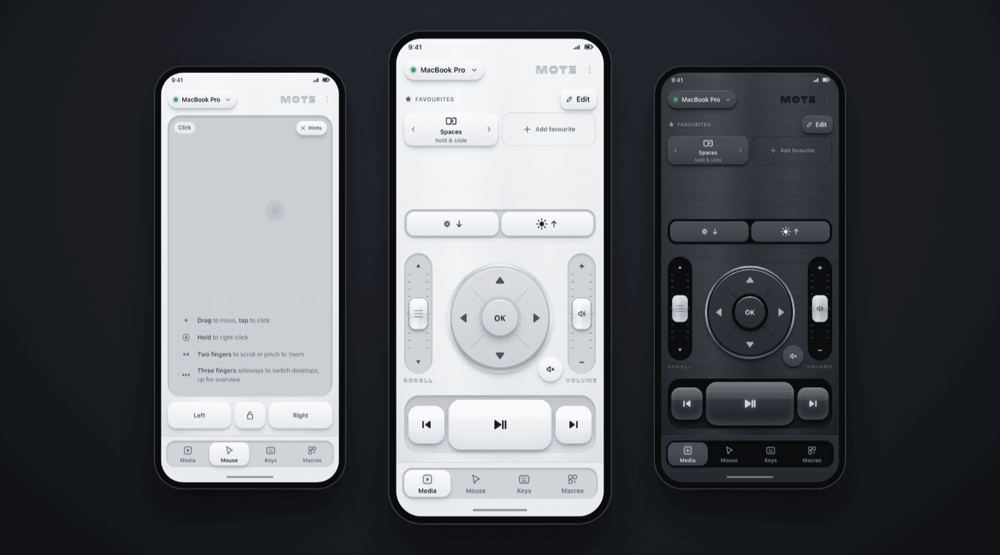
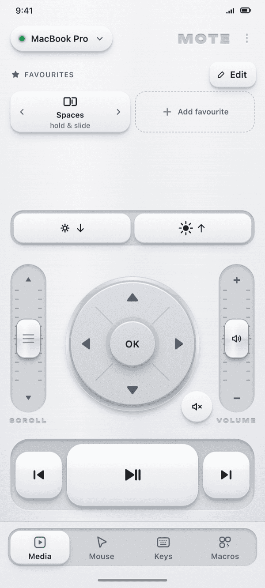
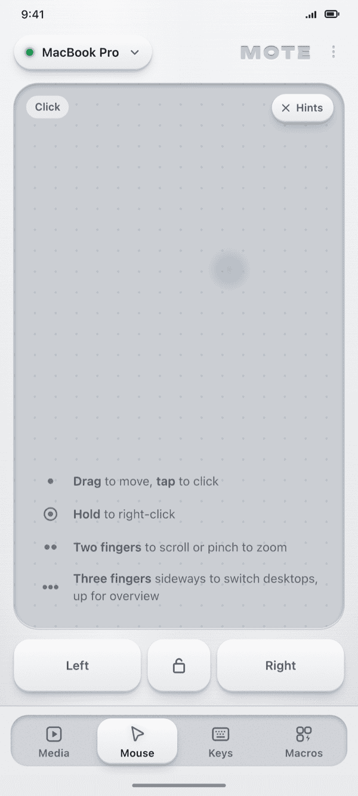
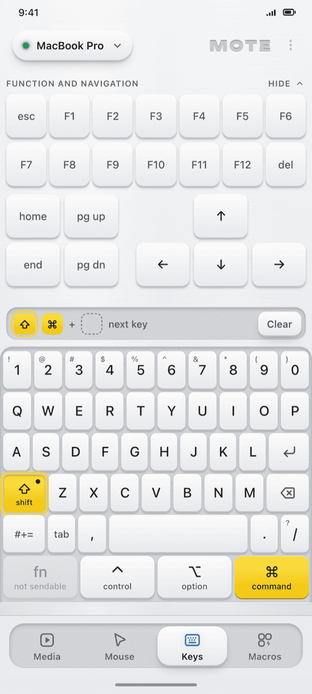
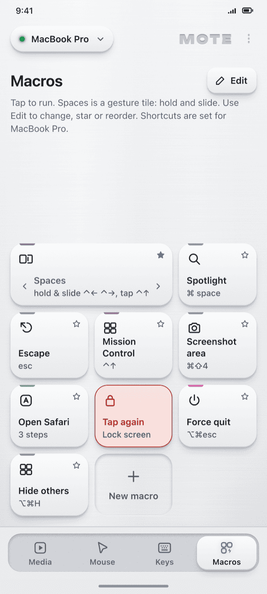
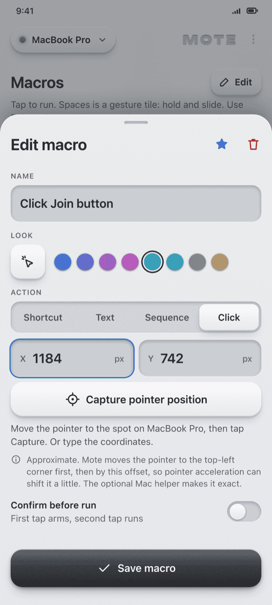
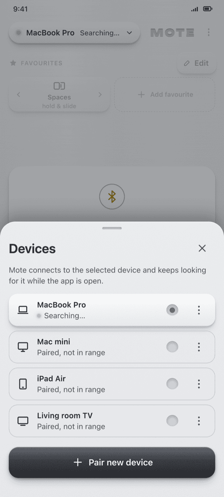
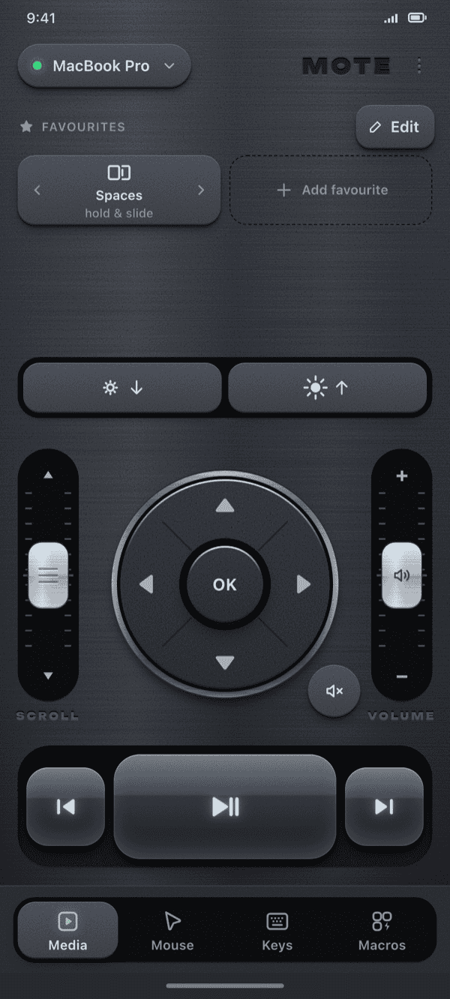

<p align="center">
  <h1 align="center">MOTE</h1>
</p>

<p align="center"><b>Your Android phone, as a precision remote for your Mac.</b><br>
Media keys, D-pad, touchpad, keyboard and macros. Over Bluetooth, Wi-Fi or Tailscale.</p>

<p align="center">
  <a href="https://github.com/tusharpandey13/mote/releases/latest"></a>
  
  
  
</p>

<p align="center">
  
</p>

<p align="center">
  <a href="https://github.com/tusharpandey13/mote/releases/latest"><b>Download APK</b></a>
  &nbsp;&middot;&nbsp;
  <a href="https://tusharpandey.com/mote/"><b>Website</b></a>
</p>

<p align="center"><sub>Screens shown are renders of the design artboards in <a href="design/mote-v1"><code>design/mote-v1</code></a>. The app is being restyled to match them.</sub></p>

## Why Mote

- **Nothing to install on the Mac (Bluetooth).** Mote pairs as an ordinary Bluetooth keyboard, mouse and media controller. Because it is real HID, it works at the login screen too.
- **Precision extras over Wi-Fi or Tailscale.** Add the Mote Helper on your Mac and you get Unicode typing in any layout, precise brightness and click-at-point macros, at home or across your tailnet.
- **Built like hardware.** Silver and Titanium themes, a scroll lever, a tactile D-pad, sticky modifiers and haptics, in a design language worth a good remote.
- **Open source.** Kotlin app, Swift helper, a documented [protocol](docs/protocol.md). Read it, build it, audit it.

## What it does

<table>
  <tr>
    <td align="center" width="25%"><br><b>Media</b><br>Play, skip, volume and brightness levers, D-pad, Spaces and favourites.</td>
    <td align="center" width="25%"><br><b>Mouse</b><br>Touchpad with drag, tap, right-click, two-finger scroll and a drag lock.</td>
    <td align="center" width="25%"><br><b>Keys</b><br>Full keyboard with sticky modifiers.</td>
    <td align="center" width="25%"><br><b>Macros</b><br>One tap runs a chord, text or a delay sequence.</td>
  </tr>
  <tr>
    <td align="center" width="25%"><br><b>Macro editor</b><br>Record a chord and name it.</td>
    <td align="center" width="25%"><br><b>Device picker</b><br>One list for Bluetooth and helper hosts, with BT / Wi-Fi / Tailscale badges.</td>
    <td align="center" width="25%"><br><b>Dark theme</b><br>Titanium, for the couch at night.</td>
    <td></td>
  </tr>
</table>

## How it connects

| | Bluetooth HID | Wi-Fi / Tailscale + Mote Helper |
|---|---|---|
| Software on the Mac | None | [Mote Helper](#2-install-the-mac-helper-optional) (menu-bar app) |
| Pairing | macOS Bluetooth settings | 6-digit code or QR (`mote://pair` link) |
| Works at login / lock screen | Yes | No |
| Typing | US layout only | Any Unicode |
| Brightness | Consumer keys, unconfirmed | Precise (helper path) |
| Click-at-point macros | No | Yes (main display) |
| Link | Foreground service keeps it alive with the screen off | Reconnects while the app is on screen |
| Encryption | Bluetooth link | Wi-Fi: none. Tailscale: encrypted by WireGuard |

Both can coexist: one host list, pick a Mac from the device pill.

## Quick start

### 1. Install the app

1. Download `mote-v0.2.0.apk` and its `.sha256` from the [latest release](https://github.com/tusharpandey13/mote/releases/latest).
2. Verify: `shasum -a 256 -c mote-v0.2.0.apk.sha256`.
3. Install the APK on the phone (or `adb install -r mote-v0.2.0.apk`).
4. **Bluetooth:** open Mote, allow Nearby devices and Notifications, tap the device pill, then **Pair new device**. On the Mac go to System Settings > Bluetooth, connect to the phone and confirm the code. If Keyboard Setup Assistant opens, pick ANSI.

### 2. Install the Mac helper (optional)

```sh
curl -fsSL https://tusharpandey13.github.io/mote/install.sh | bash
```

Read the [script](site/install.sh) first. It needs no sudo, downloads the helper from GitHub Releases, verifies its SHA-256, installs into `~/Applications` and asks for Accessibility permission so it can inject input.

### 3. Pair over Wi-Fi or Tailscale

1. In Mote choose **Use Wi-Fi with Mote Helper** on first run, or device pill > **Add Mac over Wi-Fi**. No Bluetooth permission needed.
2. In the helper's menu bar choose **Pair new device**. Pick the Mac and type the 6-digit code, or scan the QR and tap **Open in the Mote app**.
3. Tailscale: turn on **Allow Tailscale connections** in the helper menu (off by default), then use **Enter address** with the MagicDNS name or `100.x` IP if the phone does not already know it.

## Security and privacy

- Pairing needs a one-time code shown on the Mac. Each device gets its own token, stored in the Android Keystore.
- Every helper session is authenticated with an HMAC; no accounts, no cloud, traffic stays on your LAN or tailnet.
- The helper menu has **Pause input** and **Revoke all devices**.
- Wi-Fi mode is plain `http`/`ws`: someone who captures the pairing exchange on the same network gets the token. Pair on a network you trust. Over Tailscale the traffic is encrypted.

Details: [`docs/protocol.md`](docs/protocol.md).

## Limitations

- Bluetooth HID cannot be exercised in an emulator; v0.2.0 was verified on one phone (Nothing Phone (2)). Tailscale from the phone is not yet tested on a device.
- Over Wi-Fi the connection runs only while the app is on screen. Sticky modifiers do not apply to clicks over Wi-Fi, and click-at-point targets the main display.
- Over Bluetooth typing is US layout only, and `fn` cannot be sent. Scroll direction assumes macOS natural scrolling.
- The touchpad has mouse semantics: no 3-finger gestures or tap-and-hold drag. Portrait only.
- The helper is ad-hoc signed and not notarized: after an update you may need to re-grant Accessibility. It does not work at the lock screen.

Full lists: [`android/README.md`](android/README.md).

## Roadmap

All planned, none promised:

- Spaces carousel / edge auto-repeat
- TLS pinning on the LAN
- Now-playing metadata (needs a helper back-channel)
- In-app QR scanning, multi-step macro editing, landscape layouts, non-US layouts
- Haptics and pointer-speed settings, Quick Settings tile and widget

## Build from source

Android needs JDK 17: `cd android && ./gradlew :app:assembleRelease`. The helper builds with `helper/build.sh` (Swift only). See [`android/README.md`](android/README.md) and [`AGENTS.md`](AGENTS.md) for tests, release and repo layout.

## Credits

- [Linkpad](https://github.com/Devdas-gupta/linkpad) (MIT): HID report descriptor layout and QoS values, see [`NOTICE`](NOTICE).
- [Unbounded](https://github.com/googlefonts/unbounded) typeface (SIL OFL 1.1), see [`android/licenses/OFL-Unbounded.txt`](android/licenses/OFL-Unbounded.txt).

License: TBD (no LICENSE file yet).
