# Mote design exports

<!-- Generated by tools/design-export/export.mjs (via tools/design-build.sh). Do not edit by hand. -->

PNG renders (@1x) of every artboard in `design/mote-v1`, grouped like the canvas. Each links to the live board. Browse them all, interactive, at [https://tusharpandey.com/mote/design/](https://tusharpandey.com/mote/design/).

Mote, an Android Bluetooth-HID remote for any BT host (Mac first). Revision 2: light (silver aluminium) is the default theme, with dark (titanium) as a variant. One material family: soft-touch caps, recessed wells, dark-anodised primary cap with LED legend, noise texture.

## Media

### 1 Media (light, default)

[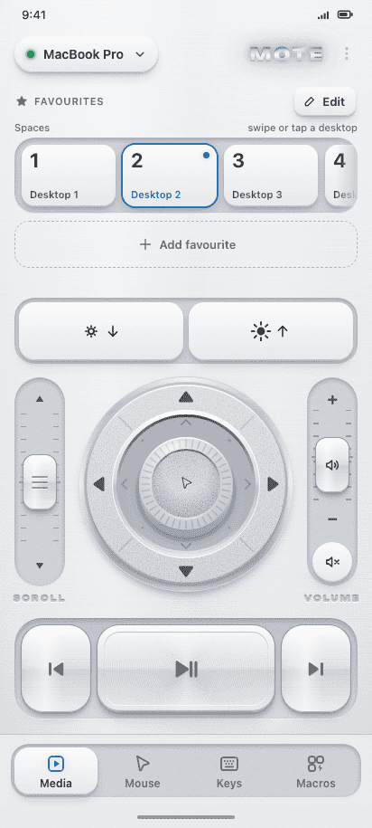](https://tusharpandey.com/mote/design/media-light.html)

`media-light` · [live board](https://tusharpandey.com/mote/design/media-light.html) · [in gallery](https://tusharpandey.com/mote/design/#media-light)

### 1 Media (dark variant)

[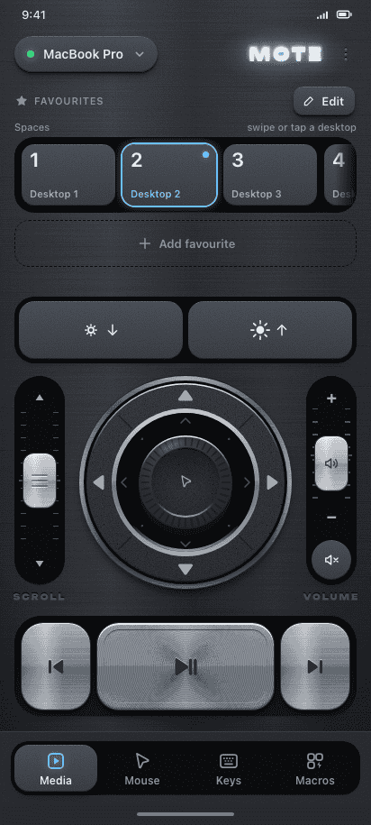](https://tusharpandey.com/mote/design/media.html)

`media` · [live board](https://tusharpandey.com/mote/design/media.html) · [in gallery](https://tusharpandey.com/mote/design/#media)

### 1 Menu sheet

[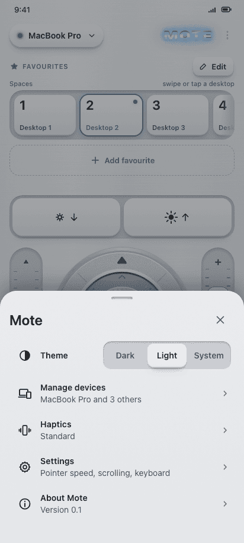](https://tusharpandey.com/mote/design/menu-sheet.html)

`menu-sheet` · [live board](https://tusharpandey.com/mote/design/menu-sheet.html) · [in gallery](https://tusharpandey.com/mote/design/#menu-sheet)

### 1 Settings (from menu)

[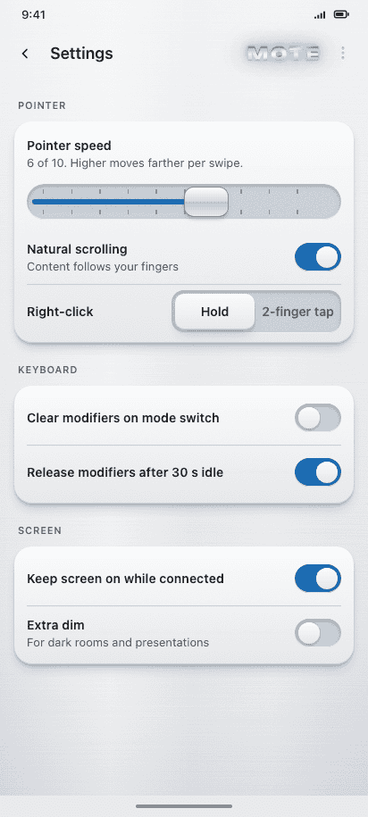](https://tusharpandey.com/mote/design/settings.html)

`settings` · [live board](https://tusharpandey.com/mote/design/settings.html) · [in gallery](https://tusharpandey.com/mote/design/#settings)

### 1 Haptics (from menu)

[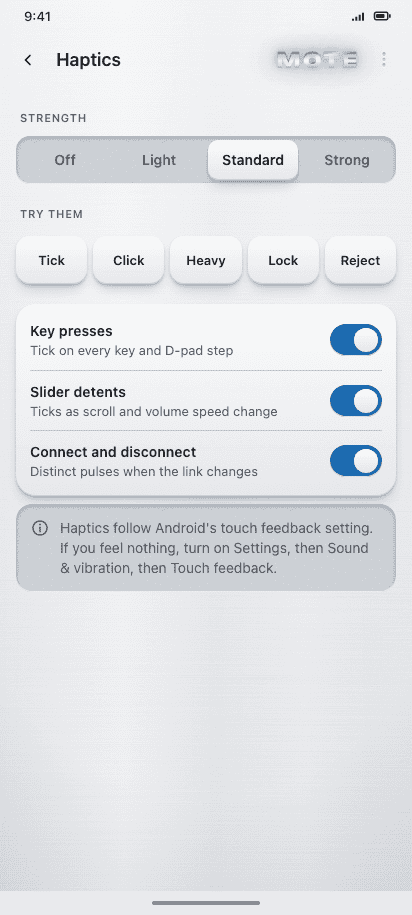](https://tusharpandey.com/mote/design/haptics.html)

`haptics` · [live board](https://tusharpandey.com/mote/design/haptics.html) · [in gallery](https://tusharpandey.com/mote/design/#haptics)

### 1 Spaces carousel (Bluetooth + helper)

[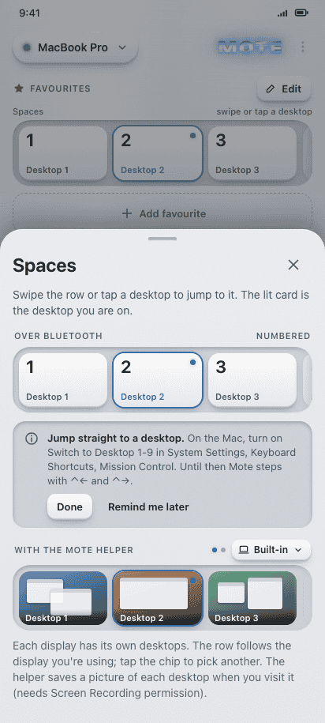](https://tusharpandey.com/mote/design/spaces-carousel.html)

`spaces-carousel` · [live board](https://tusharpandey.com/mote/design/spaces-carousel.html) · [in gallery](https://tusharpandey.com/mote/design/#spaces-carousel)

### 1 D-pad joystick states (rest, deflected, pressed)

[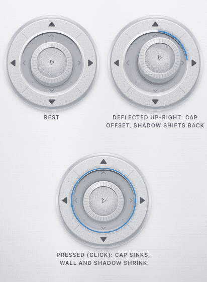](https://tusharpandey.com/mote/design/dpad-press.html)

`dpad-press` · [live board](https://tusharpandey.com/mote/design/dpad-press.html) · [in gallery](https://tusharpandey.com/mote/design/#dpad-press)

## Mouse

### 2 Mouse

[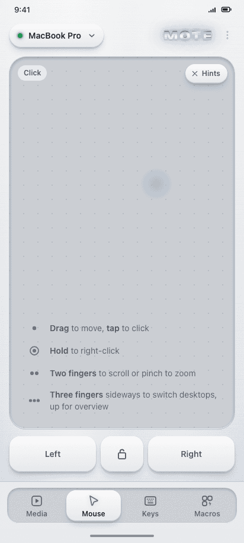](https://tusharpandey.com/mote/design/pad.html)

`pad` · [live board](https://tusharpandey.com/mote/design/pad.html) · [in gallery](https://tusharpandey.com/mote/design/#pad)

### 2 Mouse (landscape, drag lock on)

[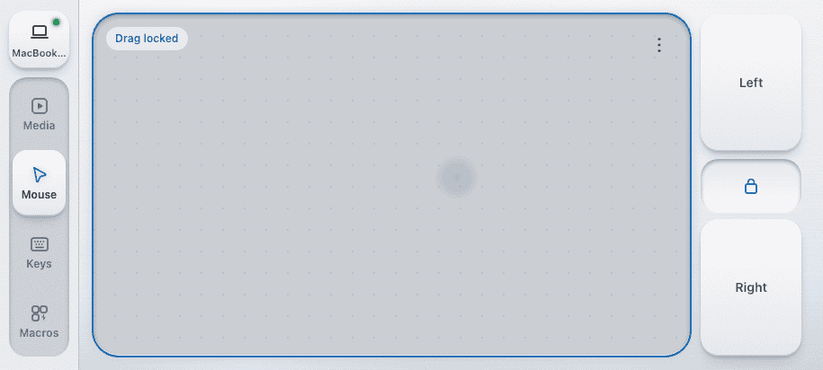](https://tusharpandey.com/mote/design/pad-landscape.html)

`pad-landscape` · [live board](https://tusharpandey.com/mote/design/pad-landscape.html) · [in gallery](https://tusharpandey.com/mote/design/#pad-landscape)

## Keys

### 3 Keys (cmd armed, shift locked)

[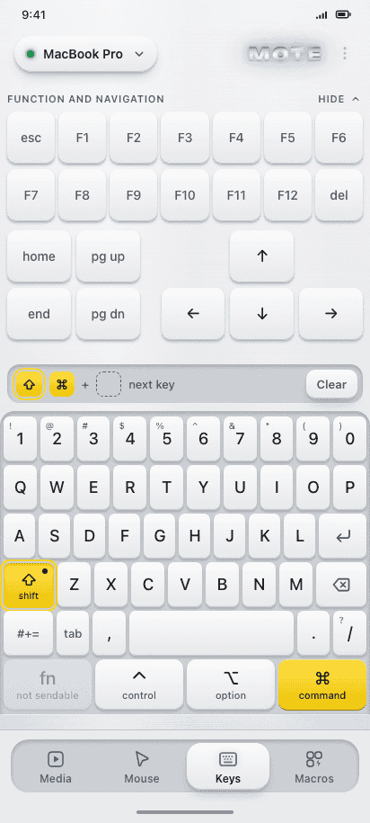](https://tusharpandey.com/mote/design/keys.html)

`keys` · [live board](https://tusharpandey.com/mote/design/keys.html) · [in gallery](https://tusharpandey.com/mote/design/#keys)

## Macros

### 4 Macros grid

[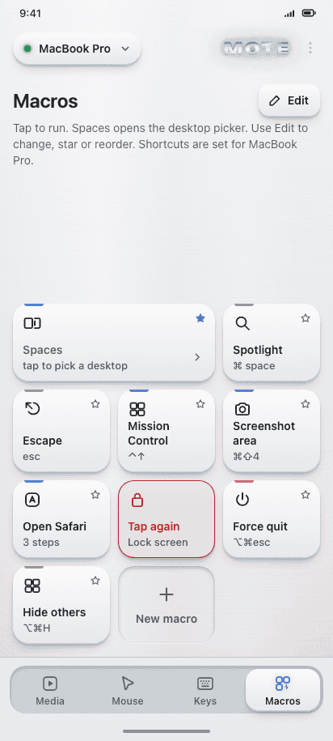](https://tusharpandey.com/mote/design/macros.html)

`macros` · [live board](https://tusharpandey.com/mote/design/macros.html) · [in gallery](https://tusharpandey.com/mote/design/#macros)

### 4 Macro editor (Click at point)

[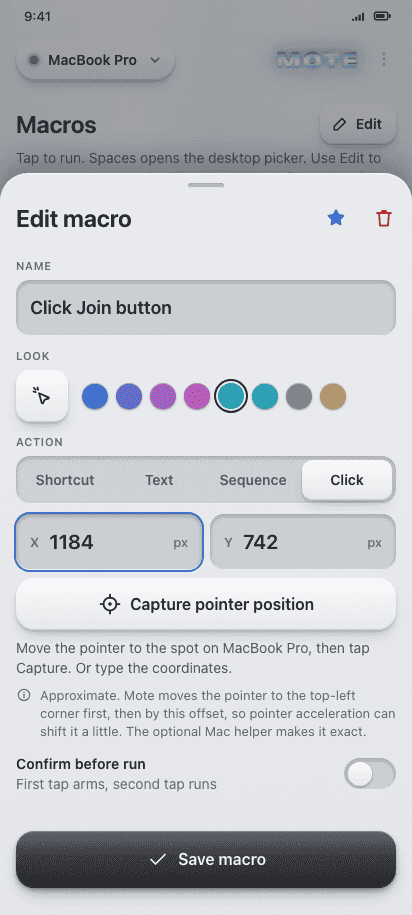](https://tusharpandey.com/mote/design/macro-editor.html)

`macro-editor` · [live board](https://tusharpandey.com/mote/design/macro-editor.html) · [in gallery](https://tusharpandey.com/mote/design/#macro-editor)

### 4 Macro running (Screenshot area)

[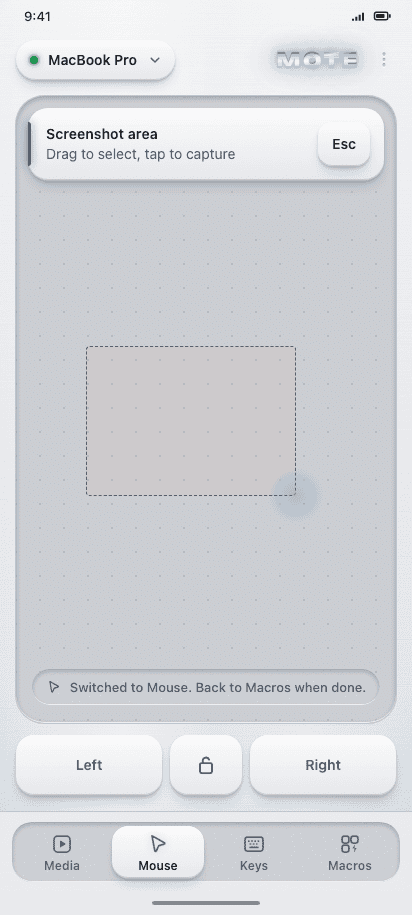](https://tusharpandey.com/mote/design/macro-running.html)

`macro-running` · [live board](https://tusharpandey.com/mote/design/macro-running.html) · [in gallery](https://tusharpandey.com/mote/design/#macro-running)

## Connection

### 5 Disconnected (auto-search)

[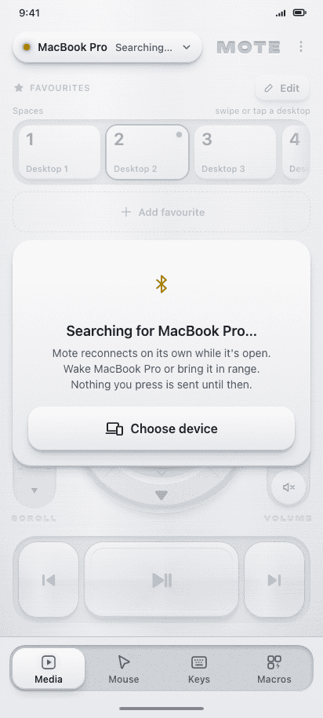](https://tusharpandey.com/mote/design/disconnected.html)

`disconnected` · [live board](https://tusharpandey.com/mote/design/disconnected.html) · [in gallery](https://tusharpandey.com/mote/design/#disconnected)

### 5 Device picker

[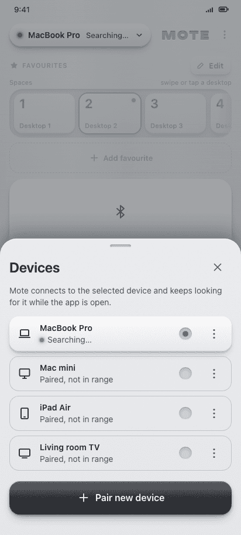](https://tusharpandey.com/mote/design/device-picker.html)

`device-picker` · [live board](https://tusharpandey.com/mote/design/device-picker.html) · [in gallery](https://tusharpandey.com/mote/design/#device-picker)

### 5 Pairing

[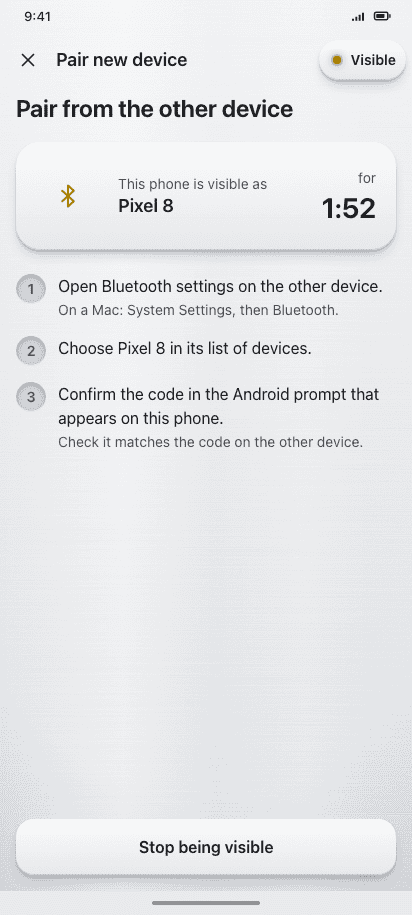](https://tusharpandey.com/mote/design/pairing.html)

`pairing` · [live board](https://tusharpandey.com/mote/design/pairing.html) · [in gallery](https://tusharpandey.com/mote/design/#pairing)

## User journeys

### Journeys index

[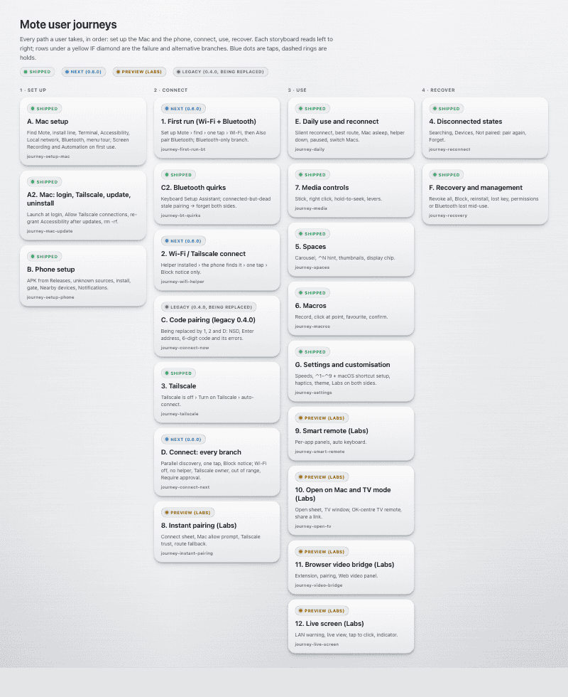](https://tusharpandey.com/mote/design/journeys-index.html)

`journeys-index` · [live board](https://tusharpandey.com/mote/design/journeys-index.html) · [in gallery](https://tusharpandey.com/mote/design/#journeys-index)

### J3 Tailscale

[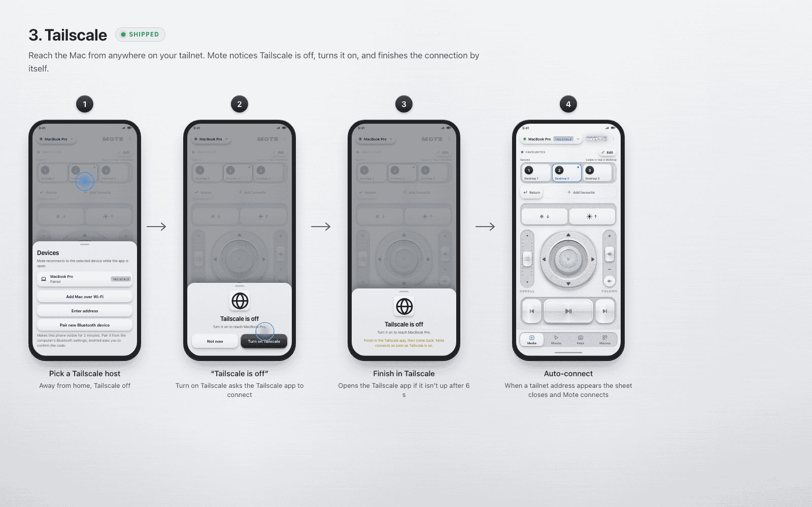](https://tusharpandey.com/mote/design/journey-tailscale.html)

`journey-tailscale` · [live board](https://tusharpandey.com/mote/design/journey-tailscale.html) · [in gallery](https://tusharpandey.com/mote/design/#journey-tailscale)

### J4 Reconnect and disconnected

[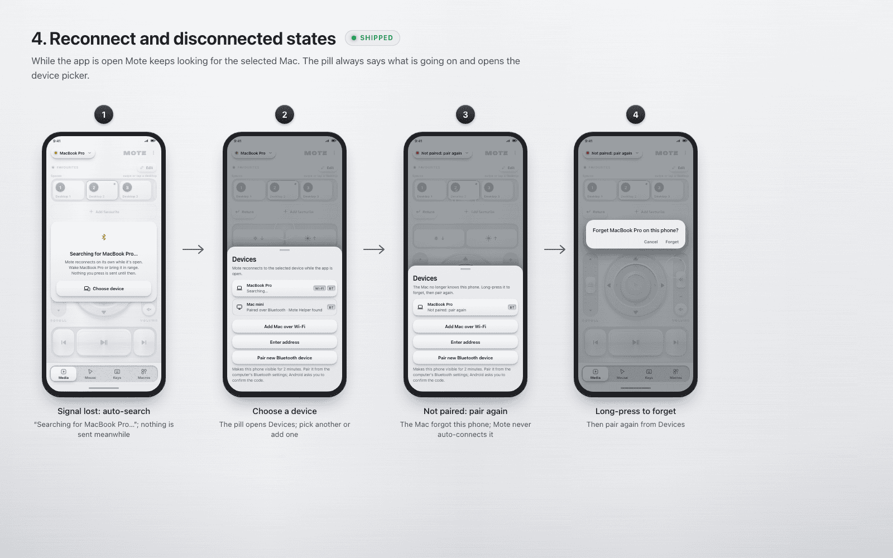](https://tusharpandey.com/mote/design/journey-reconnect.html)

`journey-reconnect` · [live board](https://tusharpandey.com/mote/design/journey-reconnect.html) · [in gallery](https://tusharpandey.com/mote/design/#journey-reconnect)

### J5 Spaces

[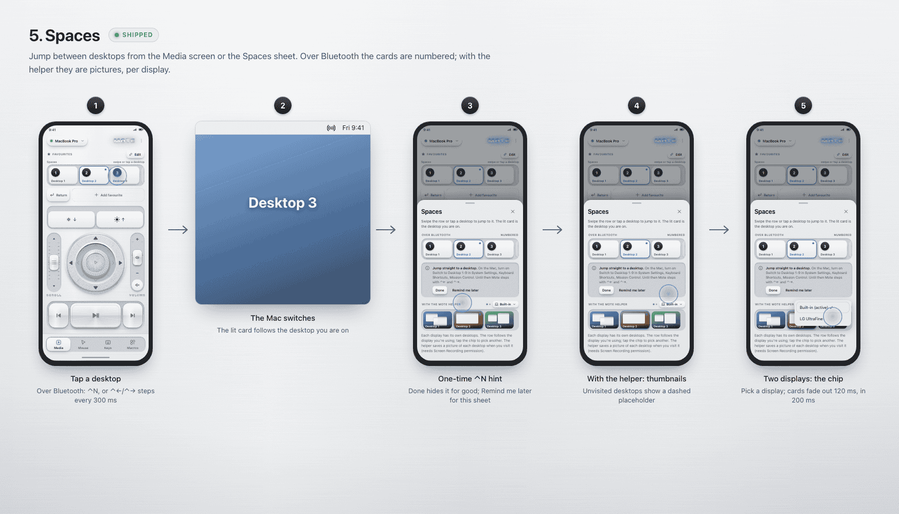](https://tusharpandey.com/mote/design/journey-spaces.html)

`journey-spaces` · [live board](https://tusharpandey.com/mote/design/journey-spaces.html) · [in gallery](https://tusharpandey.com/mote/design/#journey-spaces)

### J6 Macros

[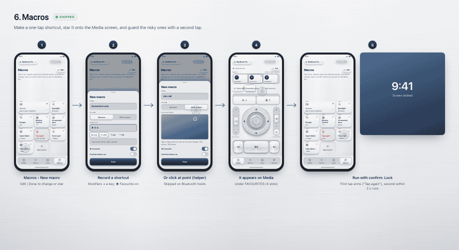](https://tusharpandey.com/mote/design/journey-macros.html)

`journey-macros` · [live board](https://tusharpandey.com/mote/design/journey-macros.html) · [in gallery](https://tusharpandey.com/mote/design/#journey-macros)

### J7 Media controls

[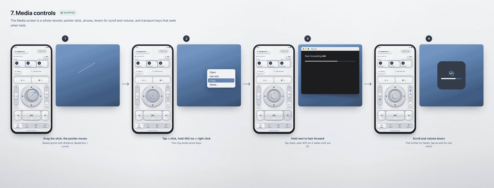](https://tusharpandey.com/mote/design/journey-media.html)

`journey-media` · [live board](https://tusharpandey.com/mote/design/journey-media.html) · [in gallery](https://tusharpandey.com/mote/design/#journey-media)

### A Mac setup

[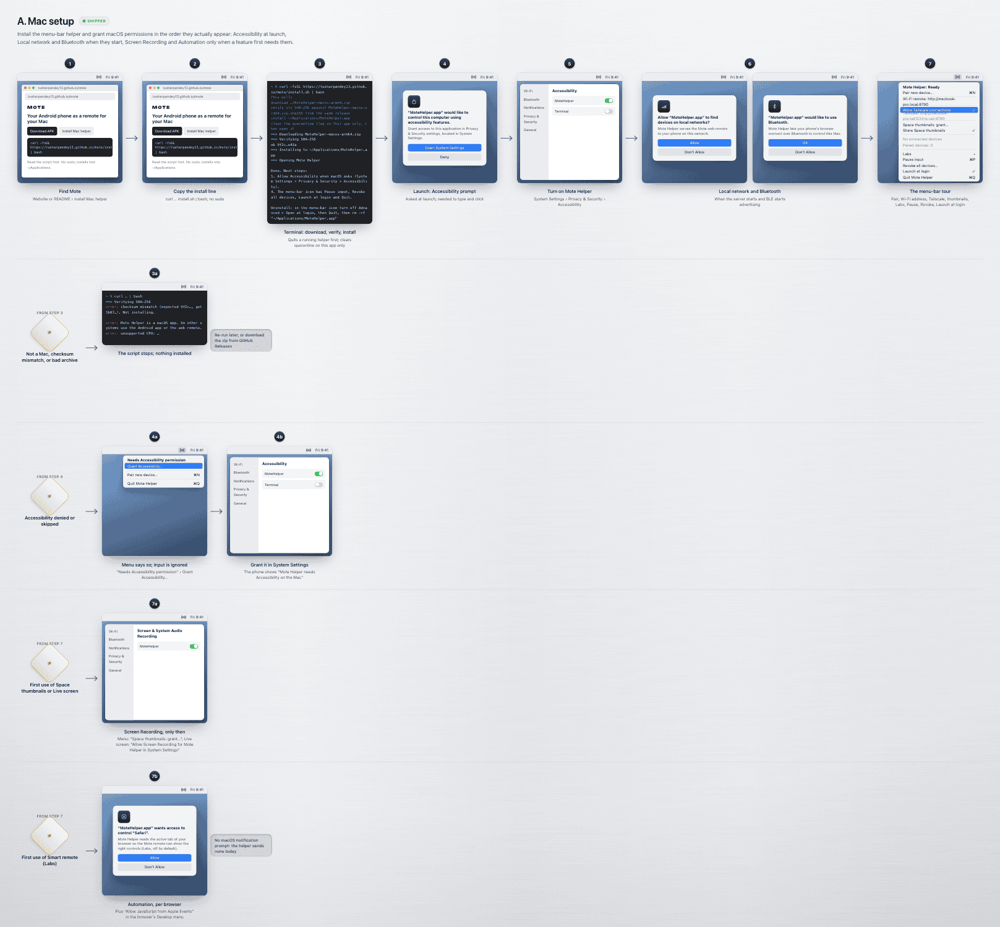](https://tusharpandey.com/mote/design/journey-setup-mac.html)

`journey-setup-mac` · [live board](https://tusharpandey.com/mote/design/journey-setup-mac.html) · [in gallery](https://tusharpandey.com/mote/design/#journey-setup-mac)

### A2 Mac: login, Tailscale, update, uninstall

[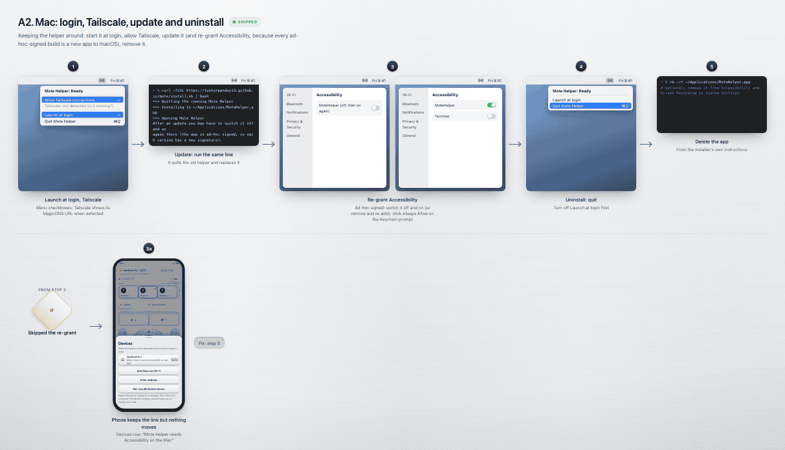](https://tusharpandey.com/mote/design/journey-mac-update.html)

`journey-mac-update` · [live board](https://tusharpandey.com/mote/design/journey-mac-update.html) · [in gallery](https://tusharpandey.com/mote/design/#journey-mac-update)

### B Phone setup

[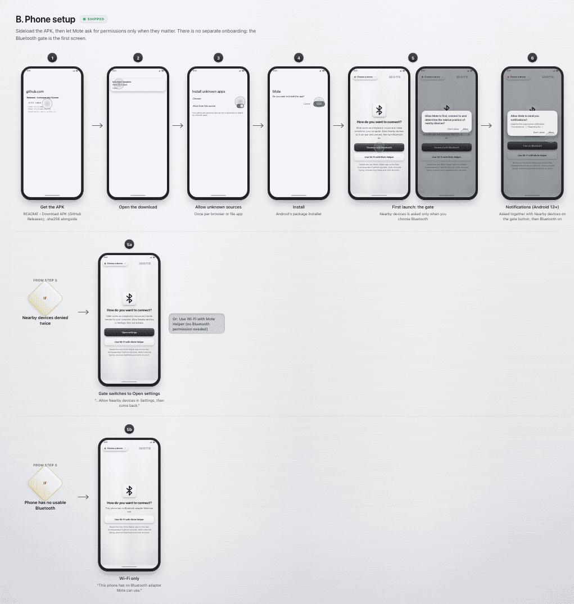](https://tusharpandey.com/mote/design/journey-setup-phone.html)

`journey-setup-phone` · [live board](https://tusharpandey.com/mote/design/journey-setup-phone.html) · [in gallery](https://tusharpandey.com/mote/design/#journey-setup-phone)

### C2 Bluetooth quirks and stale pairing

[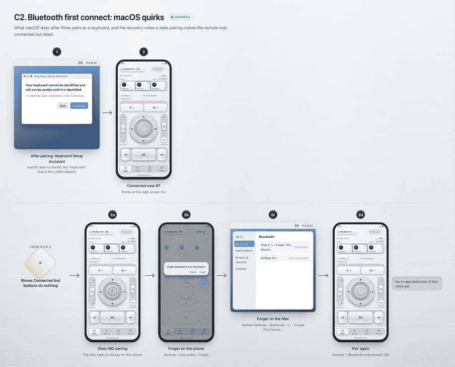](https://tusharpandey.com/mote/design/journey-bt-quirks.html)

`journey-bt-quirks` · [live board](https://tusharpandey.com/mote/design/journey-bt-quirks.html) · [in gallery](https://tusharpandey.com/mote/design/#journey-bt-quirks)

### E Daily use and reconnect

[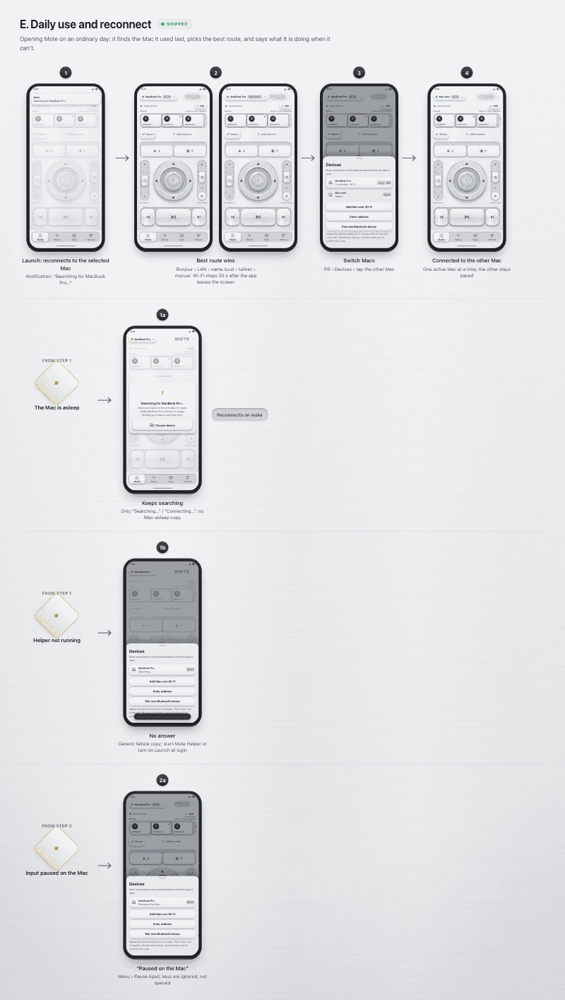](https://tusharpandey.com/mote/design/journey-daily.html)

`journey-daily` · [live board](https://tusharpandey.com/mote/design/journey-daily.html) · [in gallery](https://tusharpandey.com/mote/design/#journey-daily)

### F Recovery and management

[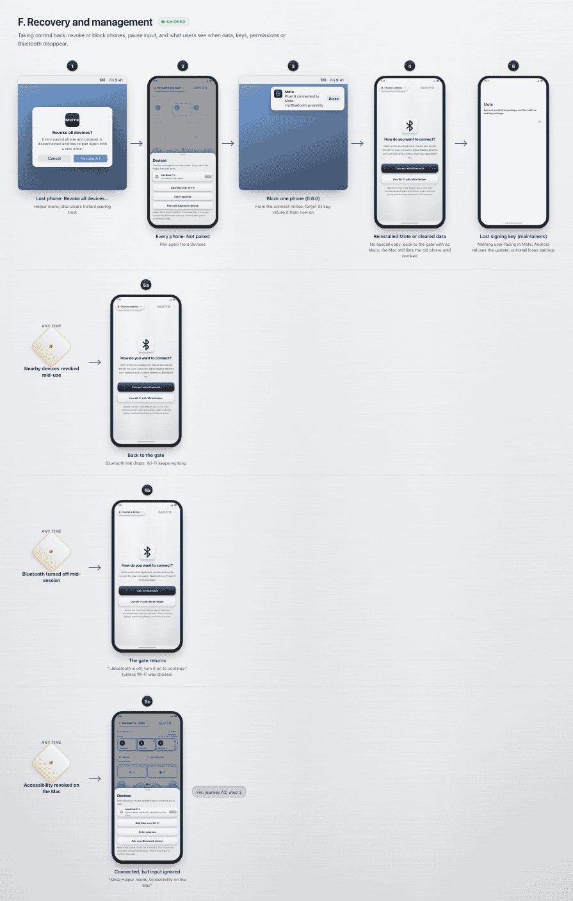](https://tusharpandey.com/mote/design/journey-recovery.html)

`journey-recovery` · [live board](https://tusharpandey.com/mote/design/journey-recovery.html) · [in gallery](https://tusharpandey.com/mote/design/#journey-recovery)

### G Settings and customisation

[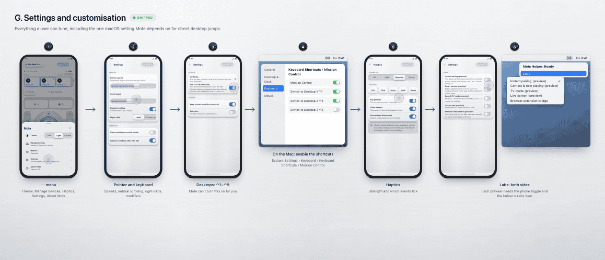](https://tusharpandey.com/mote/design/journey-settings.html)

`journey-settings` · [live board](https://tusharpandey.com/mote/design/journey-settings.html) · [in gallery](https://tusharpandey.com/mote/design/#journey-settings)

## User journeys (Next, 0.6.0)

### J1 First run (Wi-Fi + Bluetooth)

[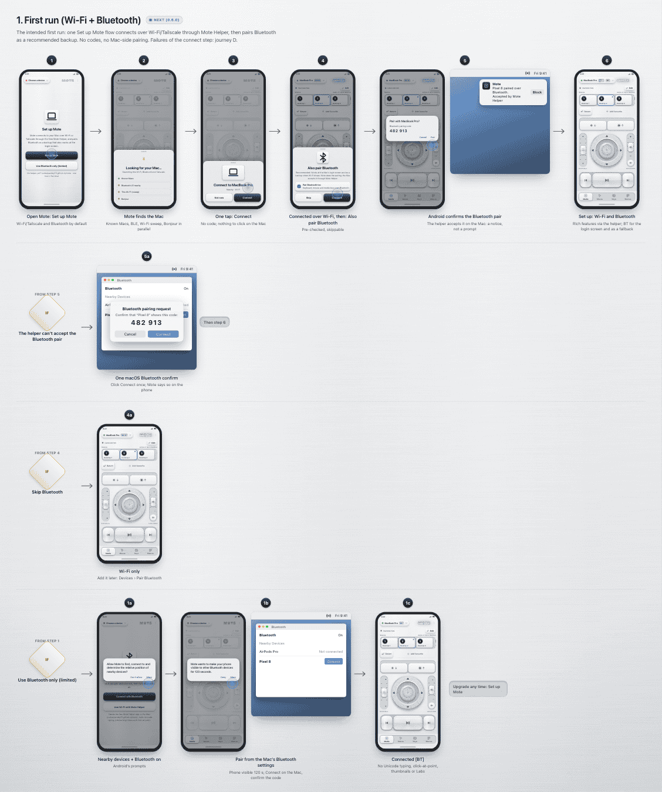](https://tusharpandey.com/mote/design/journey-first-run-bt.html)

`journey-first-run-bt` · [live board](https://tusharpandey.com/mote/design/journey-first-run-bt.html) · [in gallery](https://tusharpandey.com/mote/design/#journey-first-run-bt)

### J2 Wi-Fi / Tailscale connect

[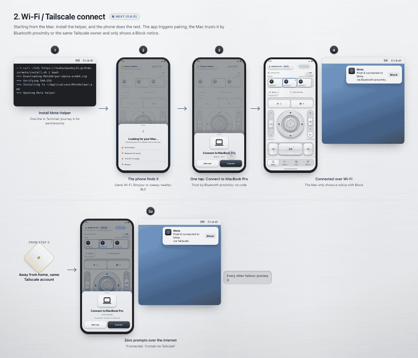](https://tusharpandey.com/mote/design/journey-wifi-helper.html)

`journey-wifi-helper` · [live board](https://tusharpandey.com/mote/design/journey-wifi-helper.html) · [in gallery](https://tusharpandey.com/mote/design/#journey-wifi-helper)

### D Connect: every branch (0.6.0)

[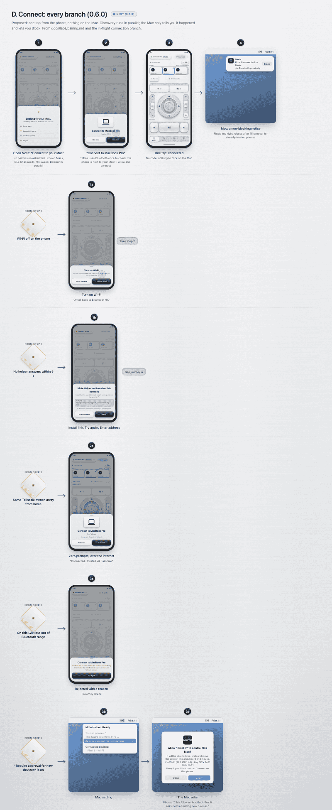](https://tusharpandey.com/mote/design/journey-connect-next.html)

`journey-connect-next` · [live board](https://tusharpandey.com/mote/design/journey-connect-next.html) · [in gallery](https://tusharpandey.com/mote/design/#journey-connect-next)

## User journeys (Preview, Labs) (Preview)

### J8 Instant pairing (Labs)

[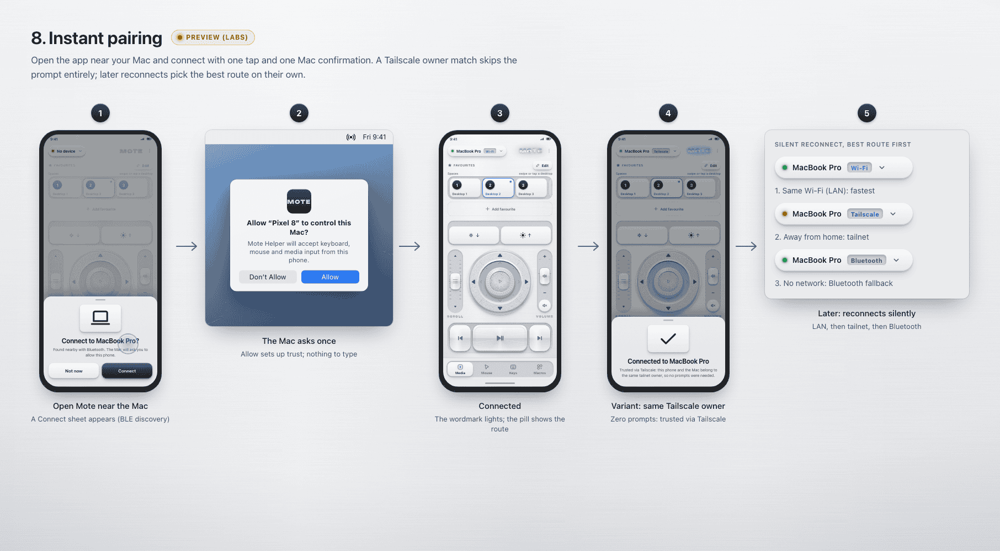](https://tusharpandey.com/mote/design/journey-instant-pairing.html)

`journey-instant-pairing` · [live board](https://tusharpandey.com/mote/design/journey-instant-pairing.html) · [in gallery](https://tusharpandey.com/mote/design/#journey-instant-pairing)

### J9 Smart remote (Labs)

[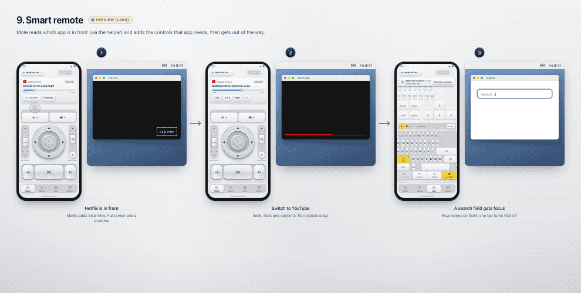](https://tusharpandey.com/mote/design/journey-smart-remote.html)

`journey-smart-remote` · [live board](https://tusharpandey.com/mote/design/journey-smart-remote.html) · [in gallery](https://tusharpandey.com/mote/design/#journey-smart-remote)

### J10 Open on Mac and TV mode (Labs)

[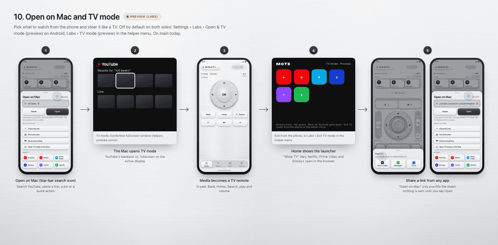](https://tusharpandey.com/mote/design/journey-open-tv.html)

`journey-open-tv` · [live board](https://tusharpandey.com/mote/design/journey-open-tv.html) · [in gallery](https://tusharpandey.com/mote/design/#journey-open-tv)

### J11 Browser video bridge (Labs)

[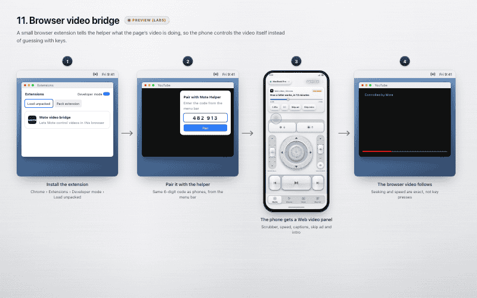](https://tusharpandey.com/mote/design/journey-video-bridge.html)

`journey-video-bridge` · [live board](https://tusharpandey.com/mote/design/journey-video-bridge.html) · [in gallery](https://tusharpandey.com/mote/design/#journey-video-bridge)

### J12 Live screen (Labs)

[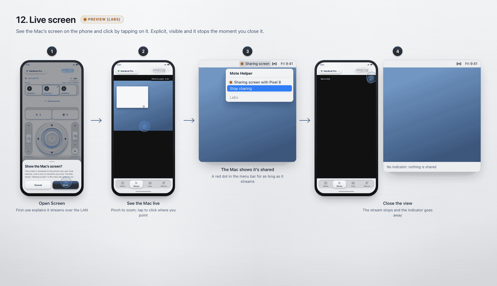](https://tusharpandey.com/mote/design/journey-live-screen.html)

`journey-live-screen` · [live board](https://tusharpandey.com/mote/design/journey-live-screen.html) · [in gallery](https://tusharpandey.com/mote/design/#journey-live-screen)

## User journeys (Legacy 0.4.0, being replaced)

### C Code pairing (legacy 0.4.0, being replaced)

[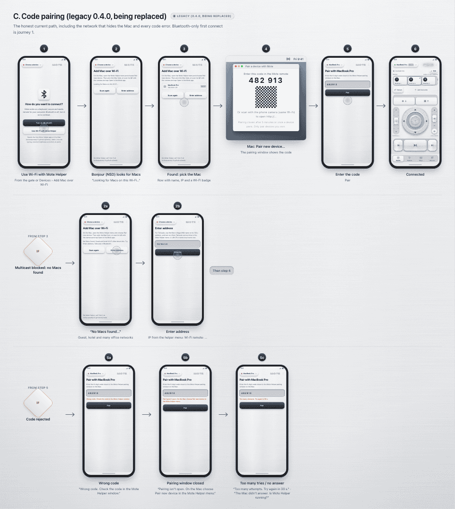](https://tusharpandey.com/mote/design/journey-connect-now.html)

`journey-connect-now` · [live board](https://tusharpandey.com/mote/design/journey-connect-now.html) · [in gallery](https://tusharpandey.com/mote/design/#journey-connect-now)
