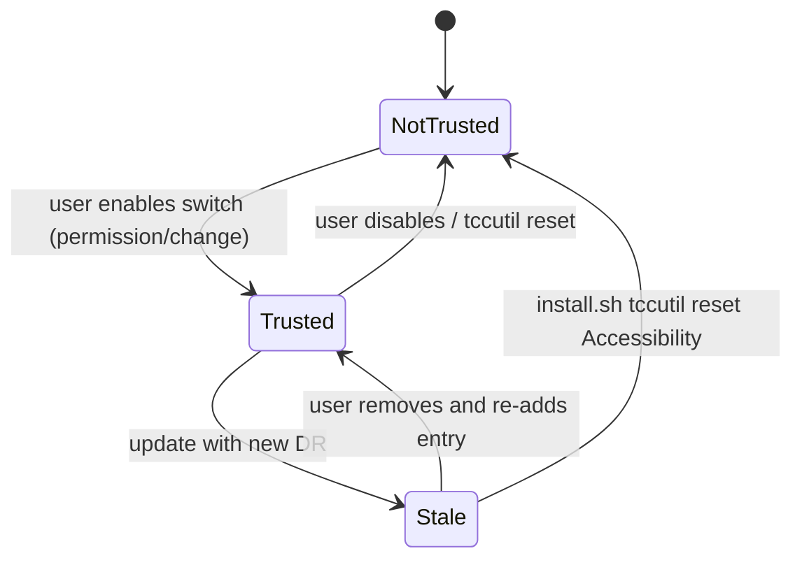
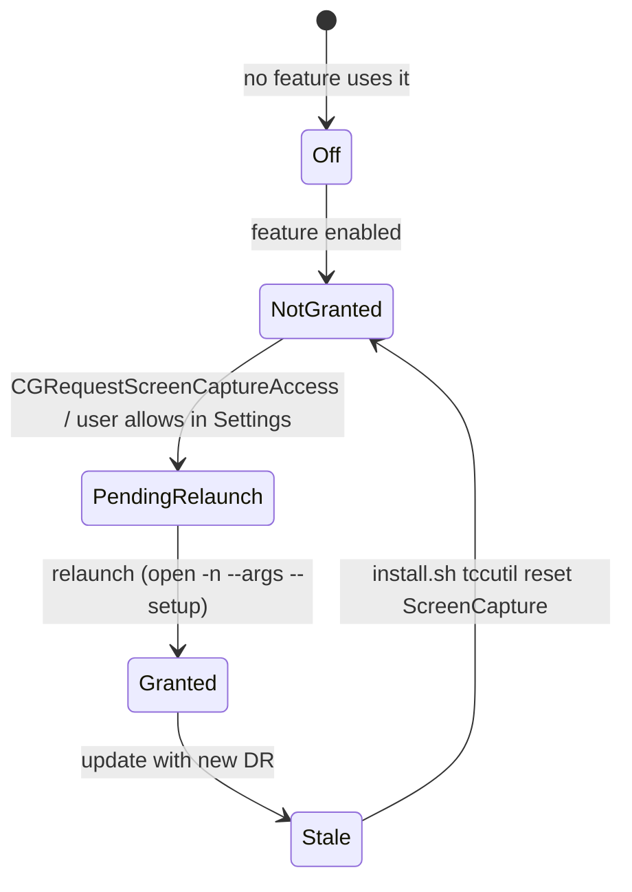
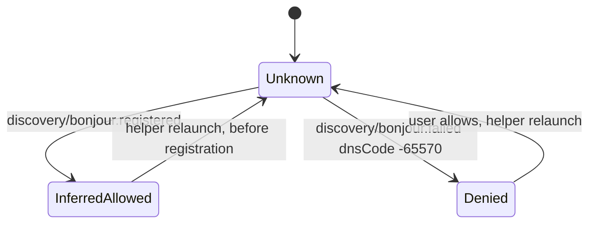
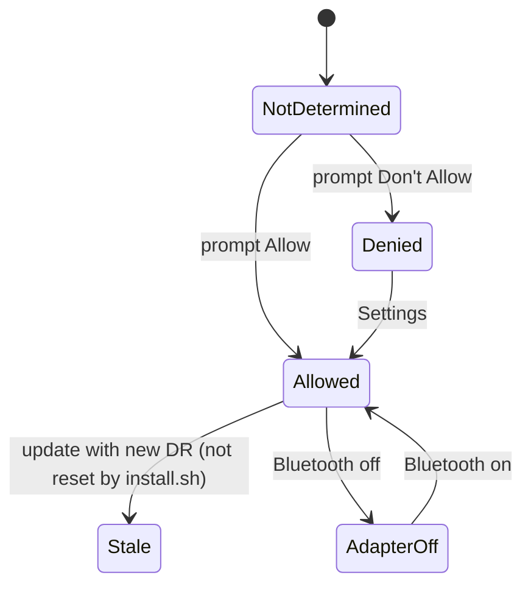
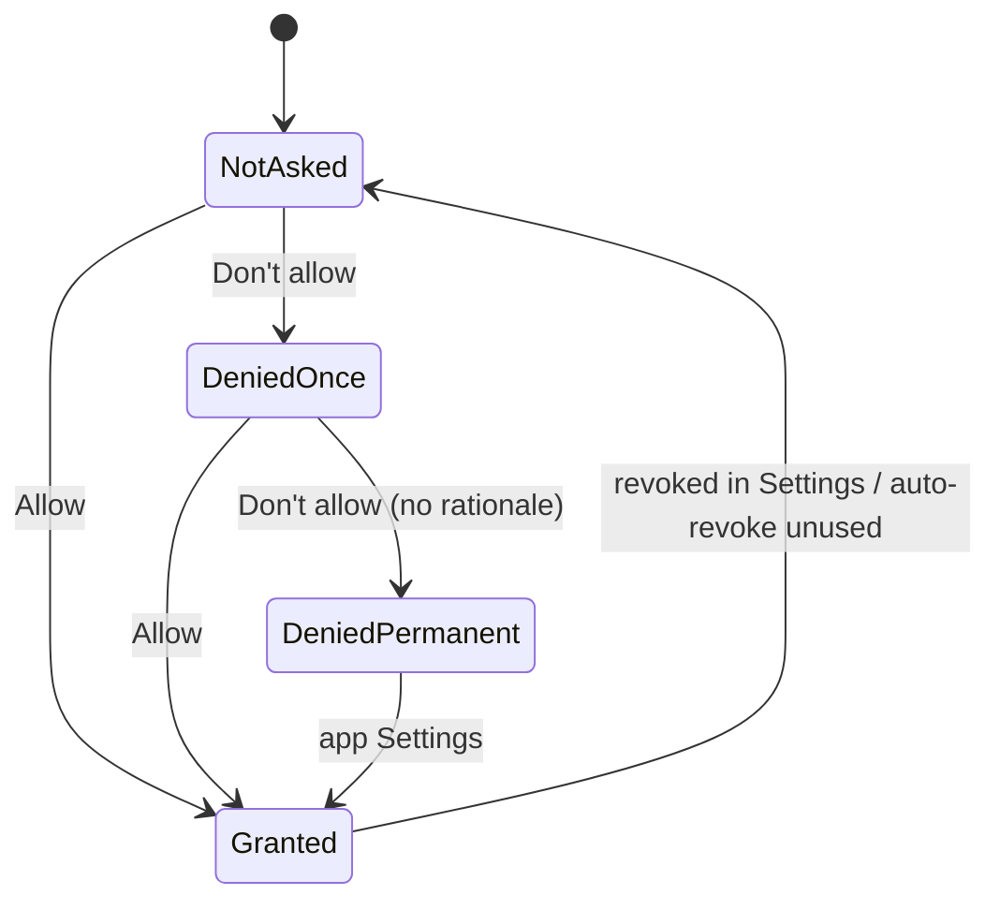
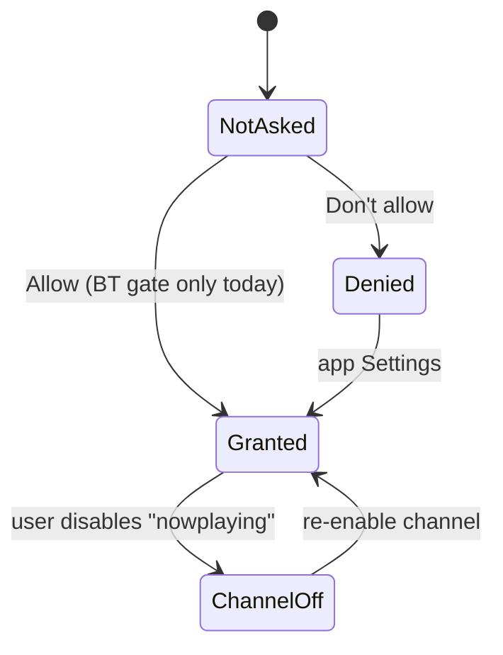

# Permissions: statecharts

Phase 2 spec. One statechart per permission the journeys depend on, with the API that reads it, what the helper/app reports, and what changes it. Derived from `helper/Sources/MoteHelper/{Permissions,Diagnostics,SetupWindow,Vault,Hub}.swift`, `site/install.sh`, `android/.../{ui/App.kt,diag/Perms.kt,pairing/BleScan.kt,labs/context/NpNotif.kt (phase 1b)}`.

"Stale after identity change": macOS keys TCC grants to the designated requirement (DR) and Keychain items to a partition (team id for Developer ID, cdhash for self-signed / ad-hoc). A new DR leaves the old grant visible in System Settings but ignored; a new partition makes the item unreadable without UI.

## UNDEFINED
- U5 Keychain unreadable: recovery action.
- U7 Local Network inference validity.
- U8 Screen Recording ground truth after relaunch (B1).
- U9 Which TCC services install.sh resets.
- U22 Whether Local Network grants go stale on a DR change (macOS keys them by bundle id + DR or by bundle id only: not documented).

## Mac: Accessibility (required)
API `AXIsProcessTrusted`; false → `notDetermined` (never `denied`). Hub re-reads every 2 s and broadcasts `state{ax}`.

| State | Reported (`diag.permissions.accessibility`) | Setup row | Menu | Effect |
|---|---|---|---|---|
| NotTrusted | apiState notDetermined, `features.input.blockedBy=accessibility-not-granted`, `fix=grant-accessibility` | "Grant" | "Needs Accessibility", "Finish setup…" | input err `ax`, `input/blocked{reason:ax}` |
| Trusted | granted | "Allowed" | "Ready" | input OK |
| Stale | notDetermined (indistinguishable from NotTrusted) | "Grant" while the switch looks on | as NotTrusted | as NotTrusted |
Tests: helper:PermissionTests#freshInstall, helper:DiagTests#accessibilityAndPause (L0); stale: MANUAL-4 (L3).

## Mac: Screen Recording (optional: Space thumbnails, Live screen)
API `CGPreflightScreenCaptureAccess` (false → notDetermined) + `detail.otherAppWindows`, `detail.otherAppWindowTitlesVisible`. Grant takes effect only after relaunch.

| State | Reported | Setup row |
|---|---|---|
| Off | `features.spaceThumbnails.state=off` | "Enable" |
| NotGranted | notDetermined, `blockedBy=screen-recording-not-granted`, `fix=grant-screen-recording` | "Grant" |
| PendingRelaunch | notDetermined, requested this run | "Relaunch helper" |
| Granted | granted, `otherAppWindowTitlesVisible=true` | "Allowed" |
B1: after grant + relaunch the row stays "Grant" (reported). Unknown whether preflight or the detail is wrong (U8). Tests: helper:PermissionTests#relaunchOfferedOnlyAfterAskingScreenRecording, helper:DiagTests#screenRecordingExposesRawData (L0); MANUAL-8 (L3).

## Mac: Local Network (recommended; macOS 15+)
No API (`api: none`). Inferred: Bonjour registered → granted; `bonjour.failed{dnsCode:-65570}` → denied; else unknown. `applies=false` before macOS 15.

| State | Reported | Setup row |
|---|---|---|
| n/a (< 15) | applies=false | "Can't check: macOS doesn't report this" |
| Unknown | state unknown, inferred=true | "Can't check: macOS doesn't report this" |
| InferredAllowed | granted, inferredFrom bonjour | "Allowed" |
| Denied | `blockedBy=local-network-denied`, `fix=open-local-network-settings`; also `features.wifi` listener -65570 | "Open Settings" |
B2: "Open Settings" while allowed (reported). Stale after identity change: U22. Tests: helper:DiagTests#localNetworkDeniedShowsPolicyDenied, helper:DiagTests#localNetworkUnknownIsNeverBlocked (L0); MANUAL-7 (L3).

## Mac: Bluetooth (recommended: BLE discovery, proximity, HID pairing)
API `CBManager.authorization`. Adapter power is separate (`ble.state`). BLE starts at launch only if already granted; Setup "Grant" starts BLE to trigger the prompt.

| State | Reported | Setup row | Effect |
|---|---|---|---|
| NotDetermined | `blockedBy=bluetooth-not-granted`, `fix=grant-bluetooth` | "Grant" | no BLE info, phone proximity `far` |
| Denied | `blockedBy=bluetooth-denied`, `fix=open-bluetooth-settings` | "Open Settings" | as above |
| Allowed | granted; `discovery/ble.advertising` | "Allowed" | proximity works |
| AdapterOff | `blockedBy=bluetooth-off`, `fix=turn-bluetooth-on` | "Allowed" (no adapter row) | as NotDetermined |
| Stale | unknown which API value macOS returns | ? | U9 |
Tests: MANUAL-5, MANUAL-6 (L3).

## Mac: Automation (optional: Smart remote, per browser)
API `AEDeterminePermissionToAutomateTarget(ask:false)` for each running scriptable browser.
States NotDetermined (`automation-ask` on phone) → Granted / Denied (`automation-denied`, `fix=open-automation-settings`). Stale after DR change: not reset by install.sh (U9). Tests: android:BlockersTest#browserWithoutAutomationIsNotSilent (L0), android:HelperIntegrationTest#smartRemoteBrowserAskedAutomationExplainsItself (L2).

## Mac: Keychain item `secrets.v3`
One read per launch with `kSecUseAuthenticationUIFail`; writes also UIFail.

```mermaid
stateDiagram-v2
  [*] --> Absent
  Absent --> Found: first launch writes empty blob (keychain/partition)
  Found --> Unreadable: update with new partition (cdhash every Mote Helper Local build; team change)
  Found --> Corrupt: blob fails to decode
  Corrupt --> Found: save() overwrites with empty secrets
  Unreadable --> Unreadable: every launch (no prompt, no repair)
```

| State | `diag.keychain.readResult` | `features.keychain` | Effect |
|---|---|---|---|
| Absent | notfound | ok | blob created |
| Found | found | ok | pairings, identity, blocked list loaded |
| Unreadable, partition mismatch | error -25308 / -25293, then `interactiveRead=ok` | ok | one interactive read per identity, item rewritten, everything loaded (U5) |
| Unreadable, denied or other failure | error, `ephemeral=true` | `keychain-unreadable`, `fix=repair-keychain` | ephemeral: memory only, never saves, no automatic trust, every phone needs Allow; leaves only via a successful read or Repair (U5, U6) |
| Corrupt | unreadable, `ephemeral=true` | `keychain-corrupt`, `fix=repair-keychain` | same ephemeral mode; never overwritten until Repair |
| Memory (`--memory-store`) | memory | ok | nothing persisted |
Menu line "Pairings aren't being saved: Keychain unavailable", "Keychain: Repair…" and the Setup row show while ephemeral. Tests: helper:VaultUnreadableTests, helper/tests/keychain.mjs, helper:VaultTests#authErrorIsNotPresentAndNeverRetriedOrOverwritten, helper:VaultTests#tolerantDecode, helper:DiagTests#keychainStatusCodes (L0); MANUAL-23 (L3).

## Android: Nearby devices (BLUETOOTH_SCAN / CONNECT / ADVERTISE, API 31+)
API 28-30: legacy BLUETOOTH/BLUETOOTH_ADMIN granted at install. Asked from the BT gate (all three + notifications) or the connect card NeedBluetooth (SCAN + CONNECT, ctx `connect`).

| State | Reported (`Perms`) | Gate | Connect card |
|---|---|---|---|
| NotAsked | bluetoothScan/Connect/Advertise false | "Connect with Bluetooth" | NeedBluetooth on `far` |
| DeniedOnce | false, rationale true | asks again | asks again |
| DeniedPermanent | false, rationale false | opens app Settings | nothing happens (D-FC-1) |
| Granted | true | READY | BLE proximity used |
Adapter off: gate "turn on". Stale after identity change: a differently signed APK cannot install over; reinstall resets to NotAsked. Tests: android:SetupPhoneJourney#deniedOnce, android:SetupPhoneJourney#deniedTwice, android:BtGateTest#permissionComesBeforeAdapterState (L0/L2); MANUAL-14 (L4).

## Android: Notifications (POST_NOTIFICATIONS, API 33+)
API <= 32: on by default, user can turn off. Channels: link notification; "nowplaying" (phase 1b).

| State | Reported | Effect |
|---|---|---|
| NotAsked | Perms notifications=false (33+) | helper path never asks (D-SP-3): no media notification |
| Granted | true | link + media notifications |
| Denied / ChannelOff | false; phase 1b `notification/blocked`, refresh on resume | none shown; Diagnostics row text |
Tests: android:SetupPhoneJourney#notifDenied (L2); TODO-SP-19, TODO-DU-17.
